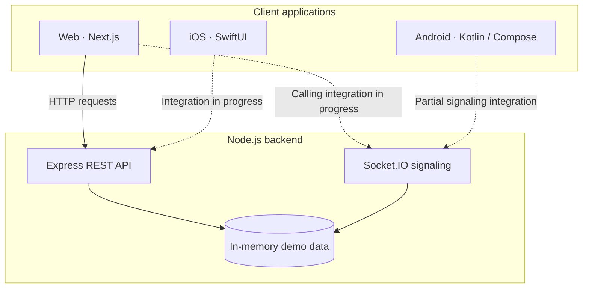

<a id="top"></a>
<h1 align="center">🤝 Friends App</h1>

<p align="center"><strong>Meet new people. Discover local experiences. Connect with creators.</strong></p>

<p align="center">A community-built, multi-platform social connection project bringing together <strong>friend discovery</strong>, <strong>local events</strong>, <strong>celebrity engagement</strong>, and <strong>customer support</strong>.</p>

<p align="center">
  
  
  
</p>

<p align="center">
  <a href="#overview">Overview</a> ·
  <a href="#features">Features</a> ·
  <a href="#tech-stack">Tech Stack</a> ·
  <a href="#getting-started">Getting Started</a> ·
  <a href="#contributing">Contributing</a>
</p>

---

## Overview

**Friends App** explores how one platform can help people meet, connect over audio/video, discover nearby events, and interact with creators. It includes role-specific experiences for individuals, event organizers, celebrities, support agents, and administrators.

This repository is an **early-stage prototype**. It contains functional API routes, demo data, a Next.js interface, Android UI scaffolding, and an iOS Swift package. Several production integrations—including real OTP delivery, persistent data storage, payments, and complete peer-to-peer calling—are **not yet implemented**.

> [!IMPORTANT]
> **Development/demo project — not production-ready.** Authentication, wallet balances, and ticket payments currently use demonstration flows. Do not deploy this repository for real users or process real payments without implementing and reviewing the required security and infrastructure.

## Features

| Area | What the project supports or demonstrates | Current scope |
| :--- | :--- | :--- |
| **Friend discovery** | Random audio/video matchmaking with Socket.IO signaling | Matchmaking and signaling scaffolding; complete media calling still needs integration |
| **Events & tickets** | Location-based event discovery, organizer event creation, ticket booking | Haversine-based search and simulated booking records; no verified payment flow |
| **Celebrity experiences** | Profiles, photo/video feeds, premium access, per-minute call pricing | Demo profiles, API workflows, and coin-based checks |
| **Customer support** | Support tickets, messages, and audio-only support call flows | Ticket APIs and signaling scaffolding |
| **Administration** | Account moderation, restrictions, and organization/celebrity verification | Backend endpoints and demo management UI |

### Five user roles

| Role | Main capabilities |
| :--- | :--- |
| **User** (`USER`) | Sign in, find friends, explore events, book demo tickets, view celebrities, contact support |
| **Organization** (`ORGANIZATION`) | Create location-tagged events and review bookings |
| **Celebrity** (`CELEBRITY`) | Maintain a profile, post media, manage availability and calling rates |
| **Support** (`SUPPORT`) | Handle customer tickets, respond to messages, and support audio calls |
| **Super Admin** (`SUPER_ADMIN`) | Review platform activity, verify accounts, and apply user restrictions |

**Call modes defined in the backend:** `RANDOM_AUDIO`, `RANDOM_VIDEO`, `CELEBRITY_AUDIO`, `CELEBRITY_VIDEO`, and `SUPPORT_AUDIO`. Customer-support video calls are intentionally not part of the call matrix.

## Tech Stack

| Layer | Technologies |
| :--- | :--- |
| **Web** | Next.js 14, React 18, TypeScript, Tailwind CSS |
| **Backend** | Node.js, Express, TypeScript, Socket.IO, JWT |
| **Android** | Kotlin, Jetpack Compose, Android WebRTC and Socket.IO dependencies |
| **iOS** | Swift 5.10, SwiftUI (Swift package) |
| **Current data layer** | In-memory TypeScript `DataStore` with seeded demo data |
| **Database design** | Prisma schema targeting PostgreSQL and PostGIS (**not yet connected to the API**) |

### Architecture at a glance



The signaling server relays WebRTC messages, but that alone does not establish a working audio/video peer connection. A separate [Prisma schema](backend/prisma/schema.prisma) describes the intended PostgreSQL/PostGIS data model; the runtime currently uses in-memory storage.

## Project Structure

```text
Friends-App/
├── backend/
│   ├── prisma/schema.prisma       # Planned relational data model
│   └── src/
│       ├── __tests__/api.test.ts  # Backend verification script
│       ├── middleware/            # Authentication and role checks
│       ├── routes/                # Auth, calls, events, support, admin, celebrities
│       ├── socket/                # Real-time signaling gateway
│       ├── store/                 # In-memory demo data
│       ├── app.ts                 # Express app
│       └── server.ts              # HTTP and Socket.IO entry point
├── web-app/
│   └── src/app/                   # Next.js interface
├── android-app/                   # Kotlin / Jetpack Compose project
├── ios-app/                       # SwiftUI source and Swift package
└── README.md
```

## Getting Started

### Prerequisites

- **Git**, **Node.js** (a recent LTS release), and **npm** for the backend and web application.
- **Android Studio** and **JDK 17** to work on the Android project.
- **macOS with a compatible Swift toolchain/Xcode** for iOS development.

### 1. Clone the repository

```bash
git clone https://github.com/nikhilkilivayil/Friends-App.git
cd Friends-App
```

If you're contributing through a fork, clone **your fork** instead and see [Contributing](#contributing).

### 2. Start the backend

In your first terminal:

```bash
cd backend
npm ci
npm run dev
```

The API starts at **http://localhost:4000**. To verify that it is responding, visit **http://localhost:4000/api/health**.

### 3. Start the web app

In a **second terminal**, from the repository root:

```bash
cd web-app
npm ci
npm run dev
```

Open **http://localhost:3000**.

By default, the web app targets `http://localhost:4000/api`. To point it to a different API, set `NEXT_PUBLIC_API_URL` in `web-app/.env.local` before starting the web server:

```dotenv
NEXT_PUBLIC_API_URL=http://localhost:4000/api
```

### 4. Explore demo accounts

The current authentication flow uses **mock OTP verification**. It does not send real SMS messages. The universal demo OTP is **`123456`**; seeded accounts also have dedicated test codes.

| Role | Demo phone number |
| :--- | :--- |
| Standard user | `+919876543210` |
| Premium user | `+919876543211` |
| Organization | `+919876543230` |
| Celebrity | `+919876543220` |
| Support agent | `+919876543240` |
| Super admin | `+919876543250` |

These numbers are **demo fixtures**, not accounts to use outside a local development environment. More details are in [`auth.routes.ts`](backend/src/routes/auth.routes.ts).

### 5. Run backend checks

From `backend/`:

```bash
npm run test
npm run build
```

`npm run test` executes the repository's existing **seven scenario groups** for API and signaling behavior. These checks are useful for development, but **do not verify real SMS delivery, payment processing, or end-to-end media streaming**.

### Native projects

<details>
<summary><strong>Android — open in Android Studio</strong></summary>

Open the [`android-app/`](android-app/) directory in Android Studio, configure an Android emulator or device, and run the app configuration. The current Android setup targets **JDK 17** and Android SDK 34.

The Android emulator is configured to reach the backend at `http://10.0.2.2:4000`. For a physical device, network settings will need to be adjusted. Native calling is still under development.

</details>

<details>
<summary><strong>iOS — verify the Swift package</strong></summary>

The [`ios-app/`](ios-app/) directory contains a **Swift package** with SwiftUI source, not a fully configured Xcode application project. On a compatible Apple development setup:

```bash
cd ios-app
swift build
```

This is a package build command, not an iOS app launch command. Network and WebRTC integrations are still in progress.

</details>

## API Reference

Selected API routes exposed by the backend:

| Method | Endpoint | Purpose |
| :--- | :--- | :--- |
| `GET` | `/api/health` | Check API status |
| `POST` | `/api/auth/send-otp` | Generate a demo OTP |
| `POST` | `/api/auth/verify-otp` | Verify demo OTP and establish a session |
| `POST` | `/api/random/match` | Create a demo random-match session |
| `GET` | `/api/events/nearby` | Find events by coordinates and radius |
| `POST` | `/api/events/:id/book` | Create a simulated ticket booking |
| `GET` | `/api/celebrities` | Browse celebrity profiles |
| `GET` | `/api/support/tickets` | List support tickets for the authenticated role |
| `GET` | `/api/admin/overview` | View super-admin overview |

Some endpoints require a **JWT access token** and an appropriate role. Source files in [`backend/src/routes/`](backend/src/routes/) are the current reference for request/response shapes.

## Contributing

Friends App is being developed as a community collaboration inspired by Brototype Malayalam's **AI Builder Challenge**. Contributions that improve correctness, documentation, testing, security, accessibility, and user experience are valuable.

A practical workflow for contributors:

1. **Explore** the [README](README.md), the code, and existing [issues](https://github.com/nikhilkilivayil/Friends-App/issues) and [pull requests](https://github.com/nikhilkilivayil/Friends-App/pulls).
2. **Discuss** a substantial change with the maintainers before implementing it, to avoid duplicated work.
3. **Fork** this repository, then create a descriptive branch from an up-to-date `main`.
4. **Keep changes focused**, run relevant checks, and update documentation where necessary.
5. **Open a pull request** against `nikhilkilivayil/Friends-App:main` describing what changed, why, and how it was tested.
6. **Respond to review feedback** with updates on the same branch.

For a first contribution, a small, well-tested fix is usually more helpful than an unrelated large refactor.

> **Contribution policy and license:** This repository does not currently include a `CONTRIBUTING.md` or `LICENSE` file. Maintainers should clarify the project's contribution and licensing terms; do not assume that public visibility grants open-source reuse rights.

## Project Background

This project is part of the community collaboration introduced by **Brototype Malayalam** in the AI Builder Challenge. [Watch the Friend Finding App walkthrough (Part 2)](https://youtu.be/ZQ7cYlANTig).

---

<p align="center"><strong>Build thoughtfully · Test thoroughly · Contribute together</strong></p>

<p align="center"><a href="#top">Back to top ↑</a></p>